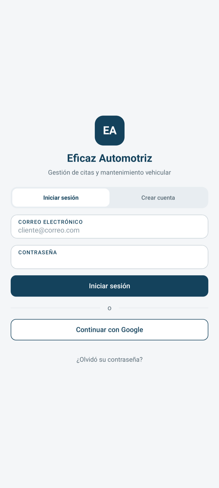
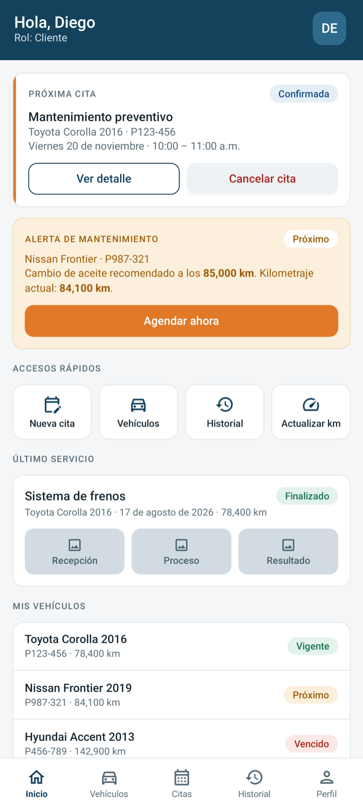
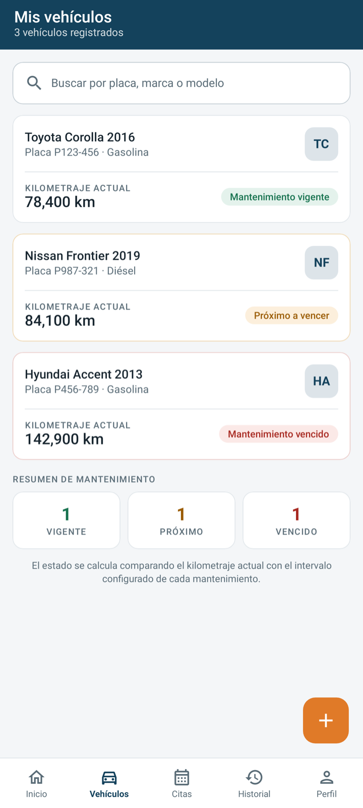
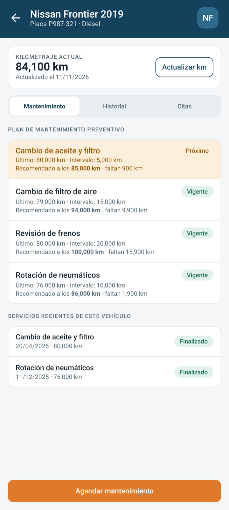
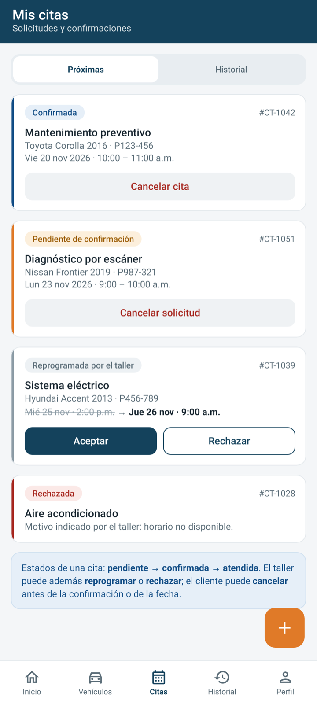
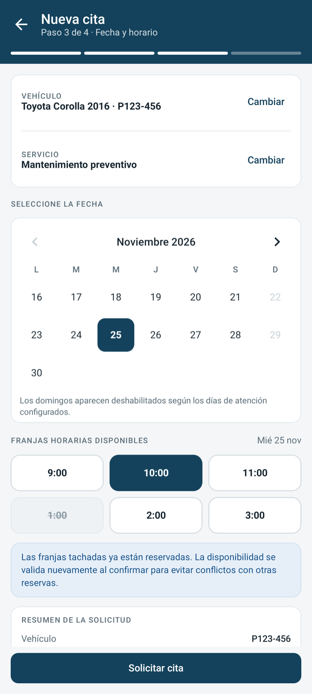
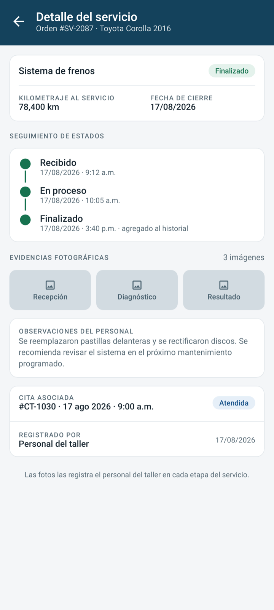
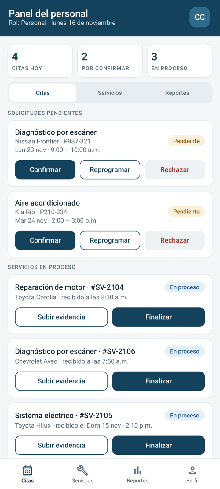
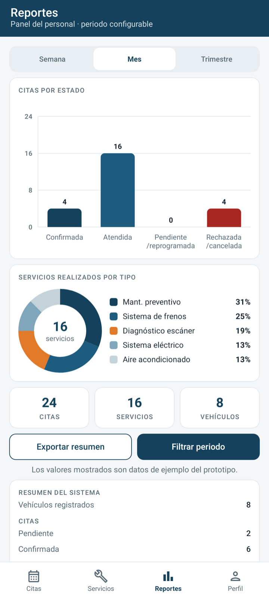

# Eficaz Automotriz · Entrega Final — App Android

Entrega Final: **22 de noviembre de 2026**. Desarrollo de Software para Móviles (DSM941), UDB Virtual.

Eficaz Automotriz es un taller de mantenimiento y reparación de vehículos ubicado en Soyapango, San Salvador. Según su [sitio oficial](https://eficazautomotriz.com/), atiende con citas programadas y recomienda agendar la cita previa por WhatsApp; entre sus servicios están el mantenimiento preventivo, el sistema de frenos, el sistema eléctrico, el diagnóstico por escáner, la reparación de motor y el aire acondicionado.

Esta app resuelve el problema planteado en la Etapa 1: llevar a un solo lugar, en el teléfono, la cita, el seguimiento de la orden de servicio y el mantenimiento preventivo de cada vehículo. El **cliente** pide su cita en una franja libre, ve el avance de su vehículo con fotos y recibe la alerta de mantenimiento según el kilometraje. El **personal** del taller confirma o reprograma citas, abre y cierra órdenes con evidencia fotográfica y consulta reportes. Los cupos, intervalos y umbrales del sistema son parámetros configurables del prototipo, no datos del taller.

Está hecha con Jetpack Compose y Firebase. Las reglas de negocio están en el módulo `:core` (Kotlin puro) y las pantallas en `:app`. Las rutas `ui/` y `viewmodel/` de este documento cuelgan de `app/src/main/kotlin/com/eficazautomotriz/app/`; las de `core/`, de `core/src/main/kotlin/com/eficazautomotriz/`.

## Funciones por rol

**Cliente**

- Registro con correo o entrada con Google; recuperación de contraseña.
- Inicio con la próxima cita, la alerta de mantenimiento y el último servicio.
- Vehículos: alta, detalle con el plan de mantenimiento preventivo, actualización del kilometraje y baja.
- Nueva cita en cuatro pasos (vehículo, servicio, fecha y franja libre). Mis citas en tiempo real: cancelar y responder una reprogramación.
- Historial de servicios y detalle de la orden con su línea de tiempo y sus fotos.

**Personal**

- Panel de citas en tiempo real: confirmar, rechazar o reprogramar.
- Órdenes de servicio: recepción desde una cita, evidencias de cámara y galería, avance a «En proceso» y cierre con kilometraje.
- Reportes con gráfica de barras (citas por estado) y de dona (servicios por tipo), por semana, mes o trimestre, con resumen para compartir.
- Configuración de franjas horarias y de los catálogos de servicios y mantenimientos.

## Tecnologías

Versiones tomadas de `gradle/libs.versions.toml` y `app/build.gradle.kts`.

| Tecnología | Versión |
|---|---|
| Kotlin | 2.0.21 (JVM 17) |
| Android Gradle Plugin | 8.7.3 (`compileSdk` y `targetSdk` 35, `minSdk` 26) |
| Jetpack Compose BOM · Material 3 | 2024.12.01 |
| Navigation Compose | 2.8.5 |
| Lifecycle (ViewModel y runtime Compose) | 2.8.7 |
| Kotlin Coroutines | 1.9.0 |
| Firebase BOM (Authentication y Cloud Firestore) | 33.7.0 |
| Google Play Services Auth (Google Sign-In) | 21.3.0 |
| Coil (imágenes) | 2.7.0 |
| OkHttp (subida a Cloudinary) | 4.12.0 |
| JUnit 5 · Robolectric (pruebas) | 5.10.2 · 4.14.1 |

## Integrantes

| Integrante | Carnet | Rama | Parte en la Entrega Final |
|---|---|---|---|
| Christian Gustavo Crespín Lozano | CL060107 | `dev/crespin` | Tema, componentes base, contraste, login, barra inferior y ViewModels de sesión |
| Diego Guillermo Esnard Romero | ER231474 | `dev/esnard` | Documentación KDoc de reglas de negocio, `ReportService`, repositorios y mappers de Firestore |
| Diego René López Martínez | LM231893 | `dev/lopez-martinez` | Pantallas del cliente (pulido UX/UI), ViewModels del cliente y pruebas de fuente al 130 % |
| Eduardo Ezequiel López Rivera | LR230061 | `dev/lopez-rivera` | Pantallas y ViewModels del personal, `LICENSE`, capturas, README y cierre |

Cada integrante trabajó en su rama `dev/<apellido>` y la integró a `main` por pull request.

## Documentos de investigación

- Firebase aplicado al proyecto (Foro 2): [docs/etapa3/foro2/INVESTIGACION-FIREBASE.pdf](docs/etapa3/foro2/INVESTIGACION-FIREBASE.pdf).
- Las reglas de negocio y decisiones de la Etapa 2: [docs/etapa2/REGLAS-Y-DECISIONES.md](docs/etapa2/REGLAS-Y-DECISIONES.md).

## 1. Configuración

Ningún secreto se versiona: `app/google-services.json` y `local.properties` están en `.gitignore`. Las plantillas son `app/google-services.json.example` y `local.properties.example`.

**Firebase**

1. Crear el proyecto y habilitar Authentication con **Email/Password** y **Google**.
2. Crear Firestore en modo **producción** y publicar `firestore.rules`.
3. Crear el índice de `firestore.indexes.json` (`firebase deploy --only firestore:indexes`).
4. Descargar `google-services.json` a `app/`. Sin él la app compila, pero abre con el aviso «Firebase no configurado».
5. Registrar el SHA-1 de debug (`./gradlew :app:signingReport`) para Google Sign-In.

**Cloudinary.** Un upload preset **unsigned** con carpeta `eficaz/evidencias`. La app no necesita API secret.

**`local.properties`**

```
sdk.dir=/ruta/al/Android/sdk
cloudinary.cloudName=
cloudinary.uploadPreset=
google.webClientId=        # client ID web de Firebase, para Google Sign-In
demo.inMemory=false
```

**Personal (STAFF).** El registro siempre crea `role = "CLIENT"`. Para el personal, cambiar `role` a `"STAFF"` en `usuarios/{uid}` desde la consola. El primer ingreso del personal siembra los catálogos (`tiposServicio`, `tiposMantenimiento`, `configFranjas`) y reconstruye las colecciones de apoyo (`contadores`, `placas`, `ocupacion`, ver `data/firestore/SupportDocuments.kt`).

### Modo demostración (sin Firebase)

Con `demo.inMemory=true`, la compilación **debug** usa los repositorios en memoria de `core`, cargados con los datos de los mockups de la Etapa 1 (`app/src/debug/.../demo/MockupSeedData.kt`). No necesita `google-services.json` ni conexión.

- Arranca con la sesión de Diego abierta; el login aparece al cerrar sesión desde Perfil.
- Cuentas: `cliente@demo.test` y `personal@demo.test`, ambas con `Demo1234`.
- Los datos se pierden al cerrar la app, las evidencias reciben una URL ficticia y no hay Google Sign-In.
- Release nunca activa este modo.

## 2. Compilar y probar

JDK 17 y Android SDK 35 (`minSdk` 26).

```
./gradlew :core:test :app:testDebugUnitTest   # 171 + 190 pruebas, sin Firebase ni Cloudinary
./gradlew :app:assembleDebug
adb install -r app/build/outputs/apk/debug/app-debug.apk
```

## 3. Arquitectura

```
app (Android)                         core (JVM puro)
┌─────────────────────────────┐       ┌──────────────────────────────────┐
│ ui/        Composables      │       │ domain/      modelos + 3 reglas  │
│   ↓ observa StateFlow       │       │ application/ 7 servicios         │
│ viewmodel/ ViewModels       │ ───►  │ data/        interfaces + InMemory│
│ di/AppGraph  arma todo      │       │ logging/     ErrorLogger          │
│ data/firestore, cloudinary, │       └──────────────────────────────────┘
│      auth  (implementan las interfaces de core.data)
└─────────────────────────────┘
```

Ningún archivo de `ui/` importa Firebase ni OkHttp, y ningún archivo de `core` importa `android.*`. La navegación está en `ui/AppRoot.kt` y las rutas en `ui/navigation/Routes.kt`. Al arrancar, `SessionViewModel` abre el inicio del cliente o el panel del personal según el rol.

Las tres reglas de negocio, las decisiones de diseño y los límites de validación están en [docs/etapa2/REGLAS-Y-DECISIONES.md](docs/etapa2/REGLAS-Y-DECISIONES.md).

## 4. Requisitos mínimos

| Requisito | Dónde se cumple |
|---|---|
| 5 pantallas o más con navegación | 21 pantallas (`*Screen.kt`) en `ui/auth/`, `ui/client/` y `ui/staff/`; `NavHost` en `ui/AppRoot.kt` |
| Dos roles con permisos distintos | `UserRole`, `requireStaff` en `core/application/ApplicationService.kt` y `firestore.rules`. Solo el personal edita catálogos (`CatalogService`) |
| Cámara y galería | `ui/staff/evidence/EvidenceScreen.kt` (`TakePicture` y `PickVisualMedia`); compresión y subida en `data/cloudinary/` |
| Dos gráficas | `VerticalBarChart` y `DonutChart` en `ui/staff/reports/Charts.kt` (Canvas, sin librería) |
| Tres módulos con lógica real | `core/domain/rules/`: `AppointmentAvailabilityRule`, `MaintenanceStatusRule`, `ServiceTransitionRule` |
| Validación en todos los formularios | `viewmodel/validation/FormValidators.kt`, `core/domain/validation/` y `ValidationError` |
| Reglas de Firestore fuera del modo de prueba | `firestore.rules`: cada cliente lee solo lo suyo; el personal, todo |
| Sesión al arrancar y cierre en ambos roles | `viewmodel/SessionViewModel.kt` y Perfil |
| Sin credenciales en el repo | Solo las plantillas `.example` |

## 5. Guion de demo (5 minutos)

1. **Cliente.** Pide una cita: vehículo, tipo de servicio, fecha y franja libre.
2. **Personal.** Confirma la cita en el panel.
3. **Orden.** Desde la cita confirmada crea la orden de servicio.
4. **Fotos.** Sube una foto de cámara y una de galería.
5. **En proceso.** Avanza la orden.
6. **Cierre.** Finaliza con un kilometraje mayor o igual al actual y marca «Cambio de aceite».
7. **Cliente.** La cita figura Atendida, el historial muestra el servicio con fotos y el cambio de aceite queda Vigente.
8. **Reportes.** Barras de citas por estado y dona de servicios por tipo.

Cuentas en el proyecto Firebase `eficaz-automotriz` (ficticias): `cliente.demo@eficaz.test` y `staff.demo@eficaz.test` (STAFF), ambas con `Demo1234`.

## 6. Limitaciones conocidas

- Crear vehículos, citas e ids usa transacciones de Firestore: sin conexión fallan en lugar de quedar en cola.
- Las reglas limitan los contadores de `ocupacion` a ±1 por escritura, pero no los atan a una cita concreta. El personal revisa la disponibilidad de nuevo al confirmar.
- `GoogleSignIn` está marcado como deprecated por Google, aunque sigue funcionando.

## 7. Firebase

La investigación del foro está en [docs/etapa3/foro2/INVESTIGACION-FIREBASE.pdf](docs/etapa3/foro2/INVESTIGACION-FIREBASE.pdf).

**Colecciones.** Nueve de negocio: `usuarios`, `vehiculos`, `citas`, `servicios`, `evidencias`, `estadosMantenimiento`, `tiposServicio`, `tiposMantenimiento` y `configFranjas`. Tres de apoyo, sin clase de dominio: `contadores`, `placas` y `ocupacion`. El id de `usuarios/{uid}` es el `uid` de Authentication. El registro guarda `role = CLIENT`.

**Reglas.** Se publican `firestore.rules`, fuera del modo de prueba. Con sesión, el cliente lista `vehiculos` por `ownerId` y `citas` por `clientId`. Lee `servicios` y `evidencias` cuando el vehículo o la orden son suyos, y no los escribe. Crear `usuarios/{uid}` exige `role = CLIENT`, y el cliente no puede cambiarse el rol. Los catálogos se leen con sesión y los escribe solo el personal. En `contadores` el cliente solo suma 1. `placas` se crea y se borra, no se actualiza. `ocupacion` se mueve de a uno.

**Tiempo real.** Mis citas escucha `observeByClient`. El panel del personal combina `observePending` y `observeAll`. El detalle del servicio combina `observeById` y `observeByOrder`. Esas tres pantallas se actualizan si otro dispositivo cambia el dato mientras siguen abiertas.

Se leen al abrir, sin listener: el inicio del cliente, los vehículos, el historial, el perfil, los reportes, los catálogos, las franjas, la recepción, el cierre, el alta de una cita y la subida de una evidencia. El panel no escucha `servicios` (relee las órdenes al armar la pantalla). El detalle no escucha `citas` (relee la cita vinculada). El login no escucha Firestore: la sesión la sostiene Authentication.

## Mockups

Diseño de la Etapa 1 (pantallas P1–P9) hecho en Figma: <!-- ENLACE FIGMA: lo pone Eduardo -->

<!-- MOCKUPS: Eduardo agrega los PNG de Figma en docs/mockups/ con los nombres de la tabla (p1-login.png … p9-reportes.png) y cambia cada «Pendiente» por . -->

La columna «App real» se generó con el arnés de capturas `MockupShots` (Robolectric, ventana de 412 × 915 dp, datos de demostración): `./gradlew :app:testDebugUnitTest -Pshots --tests '*shots*'`. Los PNG de los mockups de la Etapa 1 todavía no están en el repositorio.

| Pantalla | Mockup (Figma) | App real |
|---|---|---|
| **P1** · Inicio de sesión | Pendiente: `docs/mockups/p1-login.png` |  |
| **P2** · Inicio del cliente | Pendiente: `docs/mockups/p2-inicio-cliente.png` |  |
| **P3** · Mis vehículos | Pendiente: `docs/mockups/p3-vehiculos.png` |  |
| **P4** · Detalle del vehículo | Pendiente: `docs/mockups/p4-detalle-vehiculo.png` |  |
| **P5** · Mis citas | Pendiente: `docs/mockups/p5-mis-citas.png` |  |
| **P6** · Nueva cita | Pendiente: `docs/mockups/p6-nueva-cita.png` |  |
| **P7** · Detalle del servicio | Pendiente: `docs/mockups/p7-detalle-servicio.png` |  |
| **P8** · Panel del personal | Pendiente: `docs/mockups/p8-panel-personal.png` |  |
| **P9** · Reportes | Pendiente: `docs/mockups/p9-reportes.png` |  |

## Licencia

[](https://creativecommons.org/licenses/by-nc-sa/4.0/deed.es)

Eficaz Automotriz © 2026 Crespín Lozano, Esnard Romero, López Martínez, López Rivera. Se distribuye bajo la licencia **Creative Commons Atribución-NoComercial-CompartirIgual 4.0 Internacional (CC BY-NC-SA 4.0)**. El texto legal completo está en [LICENSE](LICENSE) y el resumen en español, en [creativecommons.org/licenses/by-nc-sa/4.0/deed.es](https://creativecommons.org/licenses/by-nc-sa/4.0/deed.es).
