# Firebase aplicado a Eficaz Automotriz: autenticación, persistencia en Cloud Firestore y sincronización en tiempo real en la aplicación Android

Christian Gustavo Crespín Lozano (CL060107)

Diego Guillermo Esnard Romero (ER231474)

Diego René López Martínez (LM231893)

Eduardo Ezequiel López Rivera (LR230061)

Universidad Don Bosco — Educación a Distancia (UDB Virtual)

DSM941: Desarrollo de Software para Móviles, sección G01T (Virtual)

Docente: Ing. Alexander Alberto Siguenza Campos

Etapa 3: Implementación Final — Avance 2, Foro de Discusión 2

Ciclo II, 2026

8 de noviembre de 2026

## Introducción

El presente documento corresponde al Foro 2 de la Etapa 3 del proyecto de cátedra Eficaz Automotriz, en la asignatura Desarrollo de Software para Móviles (DSM941). Explica de qué manera el equipo aplicó Firebase Authentication y Cloud Firestore a la aplicación Android del taller, qué arquitectura de datos quedó en el repositorio y qué decisiones técnicas sostienen esa integración. El texto distingue lo que afirman las guías oficiales, que se cita en cada caso, de lo que es una decisión del equipo, que se declara como tal y se ancla en el código.

Eficaz Automotriz necesita dos cosas que un teléfono no puede resolver solo. La primera es saber quién entra y con qué rol. La segunda es guardar, entre varios dispositivos, los vehículos, las citas, las órdenes de servicio y las evidencias, de modo que un cliente vea lo suyo y el personal vea la operación del taller. Firebase Authentication resuelve la identidad: el proyecto habilita correo con contraseña y Google, y el identificador del usuario de dominio pasa a ser el `uid` que devuelve ese servicio (Google, 2026e). Cloud Firestore resuelve el almacenamiento: cada entidad del dominio es un documento en una colección, y las reglas del repositorio deciden quién puede leerlo o escribirlo (Google, 2026f).

La Etapa 2 dejó el núcleo en Kotlin puro, con casos de uso síncronos que devuelven `Outcome` y no lanzan excepciones para los resultados de negocio. La Etapa 3 no reescribió ese núcleo. Lo montó sobre dos módulos: `:core`, que no importa Android, y `:app`, cuyas pantallas no importan Firebase. La interfaz observa un estado; el ViewModel lo produce; los repositorios hablan con Firestore. Esa separación coincide con el flujo unidireccional de datos que describe la guía de arquitectura de Android: la interfaz representa el estado y no contiene las reglas de negocio (Google, 2026i).

Una vía distinta, documentada para cursos de aplicaciones móviles, consiste en construir el cliente contra una API REST propia y resolver ahí el registro y el inicio de sesión (Román Gallardo et al., 2020). El equipo no siguió esa vía. En su lugar, Authentication crea la credencial y Firestore guarda el perfil y el resto de los datos, sin un servidor escrito por el equipo. Las secciones siguientes describen ese recorrido: el flujo de autenticación, las colecciones y sus campos, las reglas y los índices, la sincronización en tiempo real en Mis citas, en el Panel del personal y en el Detalle del servicio, las decisiones que atan Firebase al proyecto y el análisis de lo que esa elección deja abierto.

Los valores numéricos que aparecen más adelante son parámetros del prototipo o ejemplos de formato. No describen empleados, cupos ni vehículos del taller. `SystemConfig` lo dice en el propio código: sus valores por defecto sirven para la demostración y no son políticas de Eficaz Automotriz.

## Firebase Authentication

### Proveedores

La aplicación autentica con dos proveedores y con ningún otro. El correo y la contraseña usan las operaciones de cuenta por contraseña de Firebase Authentication (Google, 2026c). Google usa el inicio de sesión con una cuenta de Google y un token de identidad que Authentication acepta como credencial (Google, 2026d). No hay teléfono ni Facebook. El registro desde la aplicación crea siempre el rol `CLIENT`. Un usuario de personal existe solo después de que alguien cambia `role` a `STAFF` en el documento `usuarios/{uid}` desde la consola. Esa decisión evita una pantalla de administración que la Etapa 1 no pedía.

La Figura 1 es la pantalla Métodos de acceso de la consola del proyecto: correo electrónico/contraseña y Google son los únicos proveedores habilitados.

**Figura 1**

*Métodos de acceso habilitados: correo electrónico/contraseña y Google*

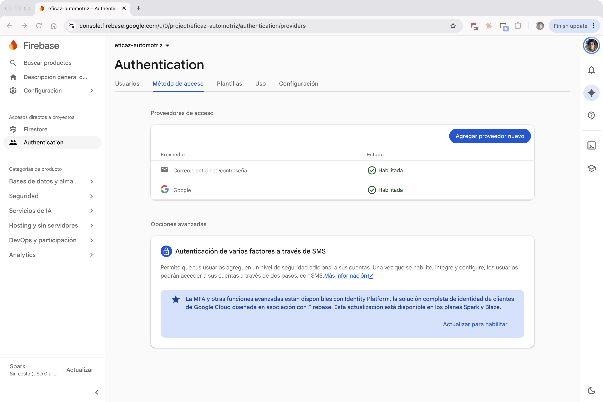

*Nota.* Captura de pantalla de la consola de Firebase del proyecto eficaz-automotriz, tomada por el equipo el 2 de noviembre de 2026.

El botón de Google de la interfaz se llama «Continuar con Google». Lo implementa `GoogleSignInButton`, con la API `GoogleSignIn` de Play Services. Pide el token de identidad mediante `requestIdToken` y el client ID web guardado en `local.properties` (`google.webClientId`). El comentario del archivo y el README registran que Google marca esa API como obsoleta. La guía actual de Android para el mismo gesto es Credential Manager, que también entrega un token de identidad para el backend (Google, 2026a). El código de esta entrega sigue en `GoogleSignIn` porque es la API que el plan de la etapa fijó y porque funciona desde el `minSdk` 26 del proyecto. Si el client ID web falta, o si la compilación está en modo demostración, el botón permanece visible y el aviso es «El inicio con Google no está configurado en esta compilación.»

### Inicio de sesión con correo

La Figura 2 resume el camino que recorre un inicio de sesión con correo, desde la pantalla hasta la ruta que corresponde al rol.

**Figura 2**

*Inicio de sesión con correo, desde LoginScreen hasta la pantalla del rol*

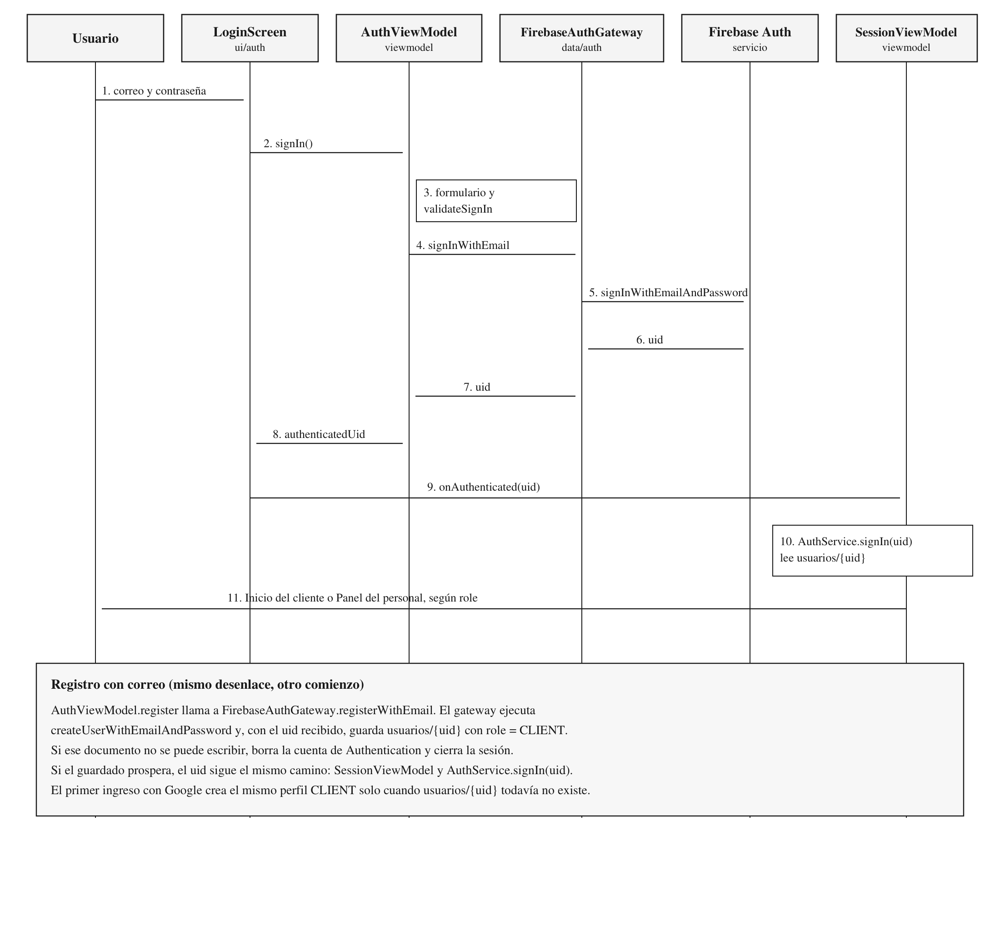

*Nota.* Elaboración propia a partir de `LoginScreen`, `AuthViewModel`, `FirebaseAuthGateway`, `AuthService` y `SessionViewModel`.

El detalle de ese camino es el siguiente. `LoginScreen` entrega el correo y la contraseña a `AuthViewModel.signIn`. El ViewModel no llama a Firebase todavía. Primero `AuthFormValidator` revisa el formulario y después `AuthService.validateSignIn` repite los límites de correo y contraseña del dominio. La contraseña debe tener al menos seis caracteres: ese mínimo es `AuthService.MIN_PASSWORD_LENGTH`. Si la validación falla, el mensaje queda en el estado de la pantalla y no sale ninguna petición.

Si la validación pasa, `authenticate` llama a `FirebaseAuthGateway.signInWithEmail`. El gateway recorta el correo y ejecuta `FirebaseAuth.signInWithEmailAndPassword`. El `uid` del usuario autenticado vuelve al ViewModel, que lo publica en `authenticatedUid`. La pantalla se lo entrega a `SessionViewModel.onAuthenticated`. Ahí, y solo ahí, entra el dominio: `AuthService.signIn(uid)` busca el documento `usuarios/{uid}` y devuelve el `User`. `SessionViewModel` no confía en el nombre que venga de Authentication para el resto de la aplicación. El actor de los demás ViewModels es ese `User`.

Con el perfil cargado, `AppGraph.ensureCatalogs` siembra `tiposServicio`, `tiposMantenimiento` y `configFranjas` cuando `tiposServicio` está vacío. Las reglas solo dejan escribir esos catálogos al personal, así que un cliente que llega a una base vacía no los crea; el fallo se registra y el ingreso continúa. Si la sesión es de personal, el mismo punto dispara en segundo plano la reconstrucción de `contadores`, `placas` y `ocupacion`. `AppRoot` elige entonces el destino: `CLIENT_HOME` («Inicio») cuando `role` es `CLIENT`, y `STAFF_PANEL` («Panel del personal») cuando `role` es `STAFF`.

La Figura 2 termina cuando la pantalla del rol ya está elegida. Lo que sigue ocurre en `SessionViewModel` y en `AppRoot`, y no cambia ese camino.

Al abrir, `SessionViewModel` lee `currentUid()`. Si hay uid, llama a `onAuthenticated` y no muestra el login. Si no hay uid, el estado es `SignedOut`. `observeUid` escucha el uid de Firebase mientras la aplicación está abierta. Si ese uid desaparece, la sesión vuelve al login con «Su sesión ya no es válida. Inicie sesión de nuevo.». Un cierre pedido por la persona usa `signOut`: publica `SignedOut` antes de avisar al gateway, para que el listener no sustituya el mensaje.

Cada carga de perfil lleva un número de generación. `startProfileLoad` cancela la carga anterior, incrementa `loadGeneration` y solo publica si esa generación sigue vigente y el uid pendiente es el mismo. Cerrar sesión durante la lectura del perfil, o durante `ensureCatalogs`, sube la generación: un resultado tardío no vuelve a poner `SignedIn` ni el ámbito de la cuenta anterior. Si `usuarios/{uid}` no existe, `signOut` muestra «Cuenta sin perfil; contacte al taller.». Si el perfil no se puede leer, el estado es `ProfileError` con «No se pudo cargar su perfil. Revise su conexión e intente de nuevo.», y la pantalla ofrece «Reintentar» y «Cerrar sesión». El texto de la excepción queda en el logger.

Un uid nuevo con la sesión cerrada no adelanta la carga. El registro y el primer ingreso con Google publican el uid antes de que exista `usuarios/{uid}`, y `onAuthenticated` corre cuando ese documento ya se escribió. Si Firebase avisa el paso de la cuenta A a la cuenta B con la sesión abierta, el ámbito vuelve a `signed-out` y empieza la carga del perfil de B.

`scopeId` es el uid de la sesión, o `signed-out` (`SIGNED_OUT_SCOPE`) si no hay nadie. `AppRoot` crea un `NavHost` y un `SessionViewModelStoreOwner` por ese valor. Al salir de la clave llama a `clear()`, y con eso descarta todos los ViewModels de pantalla, también los que la barra había guardado. `SessionViewModel` no vive en ese store: sigue en el de la actividad.

### Registro y perfil

`AuthViewModel.register` valida nombre, teléfono, correo, contraseña y confirmación. El teléfono que se guarda es la cadena de dígitos del campo. `FirebaseAuthGateway.registerWithEmail` crea la cuenta con `createUserWithEmailAndPassword` y, en el mismo `uid`, escribe el perfil:

```kotlin
User(uid, name.trim(), email.trim(), phone.trim(), UserRole.CLIENT)
```

El documento queda en `usuarios/{uid}` con `role` igual a `CLIENT`. La regla de esa colección exige las dos cosas: el `uid` del documento es el de la sesión, y el rol del documento creado es `CLIENT`. Si `users.save` falla, el gateway borra el usuario de Authentication y cierra la sesión, para no dejar una credencial sin perfil legible. El usuario puede volver a intentar el registro.

El primer ingreso con Google sigue la misma regla de rol. `signInWithGoogle` arma la credencial con `GoogleAuthProvider.getCredential(idToken, null)`, inicia sesión y busca `usuarios/{uid}`. Si no existe, crea el perfil con el nombre visible de la cuenta de Google, o con el correo si el nombre viene vacío, el correo, el teléfono de la cuenta y `role = CLIENT`. Si ese guardado falla, cierra la sesión de Firebase y deja la cuenta de Google intacta: el siguiente intento vuelve a crear el perfil. Si el perfil ya existe, no lo pisa y respeta el rol que tenga, incluido `STAFF`.

La Figura 3 muestra la cuenta de prueba `foro2.captura@eficaz.test` en la lista de usuarios de Authentication, creada con este flujo de registro.

**Figura 3**

*Usuario de prueba en Authentication, creado el 2 de noviembre de 2026*

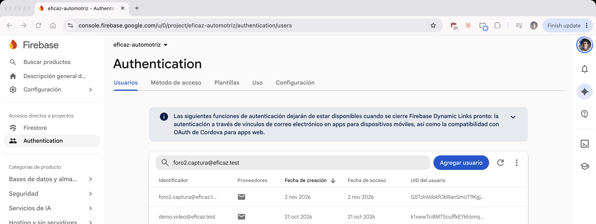

*Nota.* Captura de pantalla de la consola de Firebase. `foro2.captura@eficaz.test` es una cuenta de prueba, no un cliente del taller.

### Mensajes de error y recuperación de contraseña

Los mensajes que ve la persona están en español. `authErrorMessage` recorre la excepción y su causa. Si encuentra una `FirebaseAuthException`, `messageForAuthCode` elige la frase y el código no entra en el texto. La interfaz no importa tipos de Firebase. `AuthViewModel` escribe la clase y el mensaje técnico en el logger; `EficazViewModel.run` hace lo mismo con un fallo de Firestore y `userMessage()` muestra una sola frase, sin repetir ese texto. `CancellationException` se vuelve a lanzar, tanto en el ingreso como en el restablecimiento, para que salir de la pantalla no se presente como un error.

El control dice «¿Olvidó su contraseña?». Abre el diálogo «Restablecer contraseña», con el correo del login ya escrito, la frase «Le enviaremos un enlace para crear una nueva contraseña.» y el botón «Enviar enlace». `AuthViewModel.sendPasswordReset` valida el correo y llama a `AuthGateway.sendPasswordReset`, que en producción ejecuta `sendPasswordResetEmail` (Google, 2026c). Si el envío prospera, el diálogo se cierra y el aviso es «Le enviamos un enlace para restablecer su contraseña a » seguido del correo. Si falla, el error queda dentro del diálogo.

La Tabla 1 reproduce `messageForAuthCode`. Varios códigos comparten la misma frase. Un código que no está en la tabla, y cualquier otra excepción que no sea de red ni de demasiados intentos, usa «Ocurrió un error. Intente de nuevo.». `FirebaseNetworkException`, `UnknownHostException`, `SocketTimeoutException` y `ConnectException` usan el aviso de red. `FirebaseTooManyRequestsException` usa el de demasiados intentos. Sin red, el formulario sigue en pantalla con «Sin conexión. Revise su red e intente de nuevo.».

**Tabla 1**

*Mensajes en español para cada código de error de Firebase Authentication*

| Código de Firebase Auth | Mensaje en español |
| --- | --- |
| ERROR_WRONG_PASSWORD, ERROR_INVALID_CREDENTIAL, ERROR_USER_MISMATCH | Correo o contraseña incorrectos. |
| ERROR_INVALID_EMAIL | El correo no es válido. |
| ERROR_USER_NOT_FOUND | No existe una cuenta con ese correo. |
| ERROR_USER_DISABLED | Esta cuenta está deshabilitada. Contacte al taller. |
| ERROR_EMAIL_ALREADY_IN_USE | Ya existe una cuenta con ese correo. |
| ERROR_ACCOUNT_EXISTS_WITH_DIFFERENT_CREDENTIAL | Ese correo ya está registrado con otro método. Use el método con el que creó la cuenta. |
| ERROR_CREDENTIAL_ALREADY_IN_USE | Esa credencial ya está asociada a otra cuenta. |
| ERROR_WEAK_PASSWORD | La contraseña es demasiado débil. Use al menos 6 caracteres. |
| ERROR_OPERATION_NOT_ALLOWED | Este método de acceso no está habilitado. Contacte al taller. |
| ERROR_USER_TOKEN_EXPIRED, ERROR_INVALID_USER_TOKEN | Su sesión expiró. Inicie sesión de nuevo. |
| ERROR_REQUIRES_RECENT_LOGIN | Por seguridad, vuelva a iniciar sesión e intente de nuevo. |
| ERROR_TOO_MANY_REQUESTS | Demasiados intentos. Espere un momento e intente de nuevo. |
| ERROR_NETWORK_REQUEST_FAILED | Sin conexión. Revise su red e intente de nuevo. |

*Nota.* Textos de `AuthErrors.messageForAuthCode`. El código no se concatena al mensaje.

El formulario agrega sus propios textos antes de llamar a Firebase. En `AuthFormValidator`, los casos vacíos o inválidos incluyen: «Escriba su correo.», «Correo inválido. Ejemplo: nombre@dominio.com», «El correo no puede contener espacios.», «Escriba su contraseña.», «La contraseña debe tener al menos 6 caracteres.», «Las contraseñas no coinciden.», «Escriba su nombre.» y «Escriba su teléfono.» o «Ingrese un teléfono de 8 dígitos que inicie con 2, 6 o 7. Ejemplo: 7123-4567.».

Si la persona cierra el selector de Google, el estado 12501 no muestra nada. Los demás estados de `googleSignInMessage` tampoco muestran el número: 7 usa el aviso de red, 12502 dice «El inicio con Google ya está en curso. Espere un momento.», 10 dice «El inicio con Google no está configurado en esta compilación.» y cualquier otro dice «No se pudo iniciar sesión con Google. Intente de nuevo.». Si Google no entrega token, el aviso es «Google no devolvió un token de identidad.».

Un fallo de Firestore durante una operación de pantalla no muestra el tipo de la excepción. `EficazViewModel` lo registra y `userMessage()` lo presenta como «No se pudo completar la operación. Revise su conexión e intente de nuevo.». Sin `google-services.json`, la aplicación no construye el grafo de Firebase: muestra «Firebase no configurado: falta app/google-services.json. Descárguelo de la consola de Firebase y vuelva a compilar.»

Las Figuras 4, 5 y 6 son el inicio de sesión en el emulador. La Figura 4 muestra «¿Olvidó su contraseña?» y «Continuar con Google». La Figura 5 muestra el aviso «Correo o contraseña incorrectos.». La Figura 6 muestra el diálogo «Restablecer contraseña» con el correo ya escrito.

**Figura 4**

*Inicio de sesión, con «¿Olvidó su contraseña?» y «Continuar con Google»*

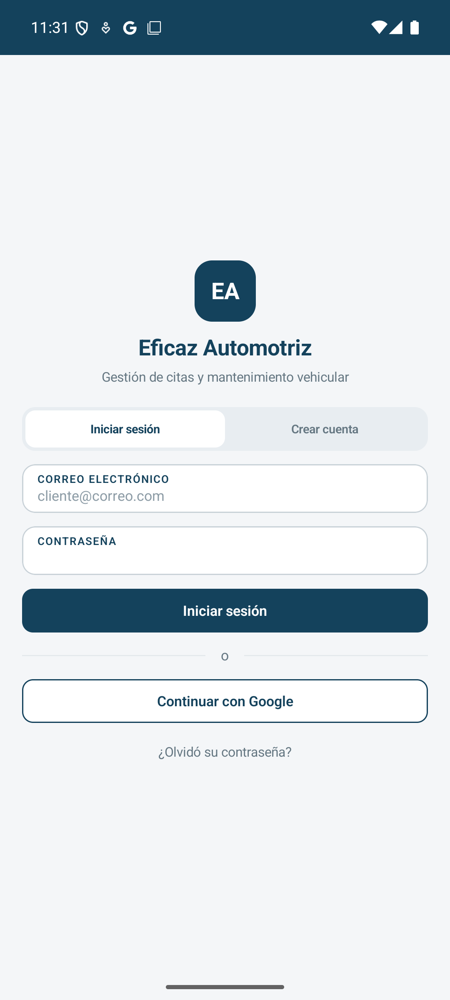{phone}

*Nota.* Captura de pantalla de la aplicación en el emulador Pixel 8 (API 36), tomada por el equipo el 2 de noviembre de 2026.

**Figura 5**

*Aviso «Correo o contraseña incorrectos.» en el inicio de sesión*

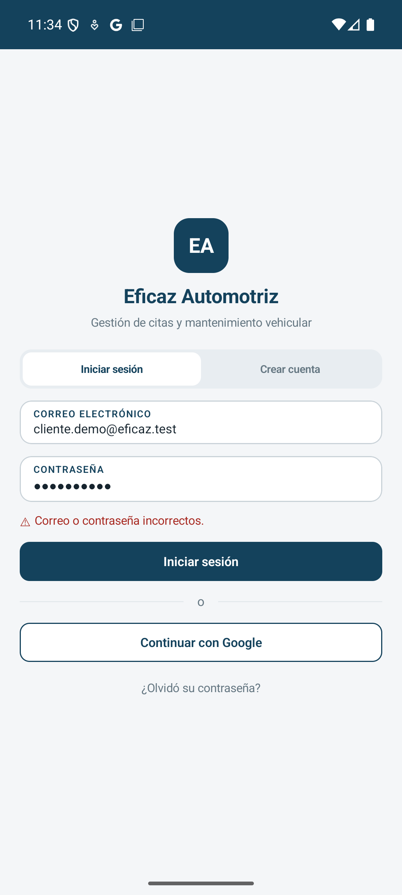{phone}

*Nota.* Captura de pantalla de la aplicación en el emulador Pixel 8 (API 36), tomada por el equipo el 2 de noviembre de 2026.

**Figura 6**

*Diálogo «Restablecer contraseña», con el correo escrito*

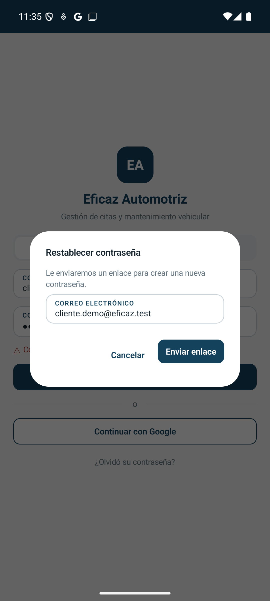{phone}

*Nota.* Captura de pantalla de la aplicación en el emulador Pixel 8 (API 36), tomada por el equipo el 2 de noviembre de 2026.

## Cloud Firestore

### De las entidades a los documentos

Firestore organiza los datos en colecciones de documentos, y cada documento es un conjunto de campos (Google, 2026b). El equipo conservó los nombres de colección de la Tabla 10 de la Etapa 1 y dejó los campos en inglés, con el mismo nombre que las propiedades Kotlin. El identificador del documento es `entity.id`, y ese mismo valor se guarda otra vez en el campo `id`. Así una lectura del mapa reconstruye el modelo sin consultar el identificador del documento por separado.

Hay nueve colecciones de negocio y tres de apoyo. Las de apoyo no tienen clase de dominio: existen para que las reglas puedan limitar las lecturas al dueño sin obligar al cliente a recorrer una colección entera. La Figura 7 muestra las relaciones. La flecha nombra el campo que guarda el identificador del otro documento. La aplicación no pide a Firestore que una esas colecciones en una sola consulta: lee cada una y el ViewModel combina los resultados (Google, 2026m).

**Figura 7**

*Colecciones de negocio y colecciones de apoyo*

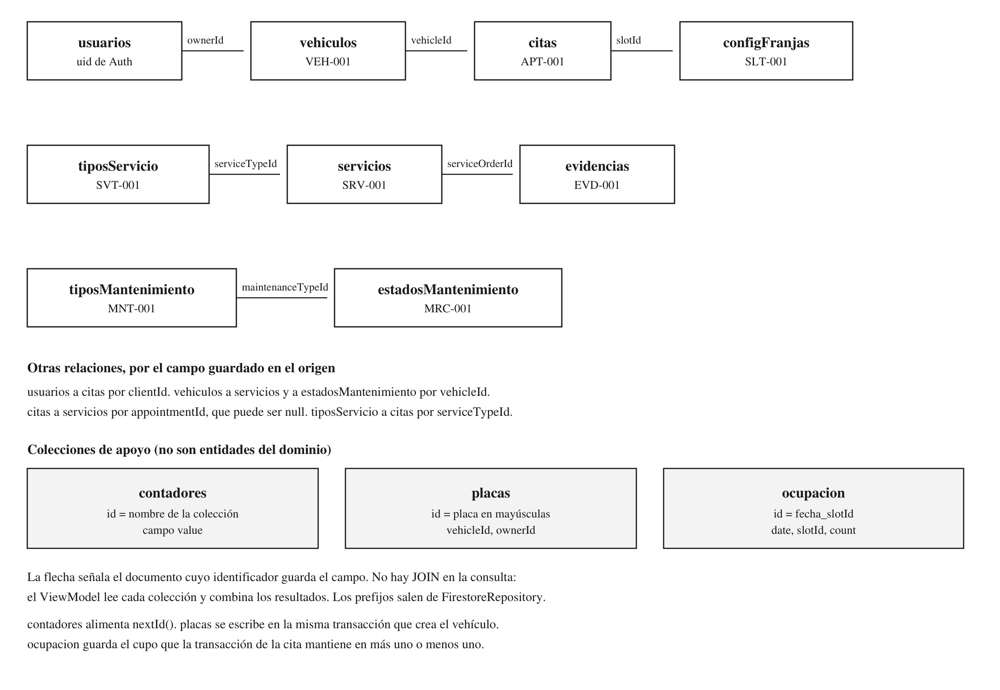

*Nota.* Elaboración propia a partir de los `COLLECTION` de los mappers, de los prefijos de `FirestoreRepository` y de `SupportDocuments`.

La Tabla 2 resume las doce colecciones. Las Tablas 3 a 14 detallan campos, tipo y un ejemplo. Todo valor de la columna Ejemplo es un parámetro ilustrativo del prototipo: muestra el formato que el mapper escribe, no un registro del taller.

**Tabla 2**

*Colecciones, identificador del documento y prefijo legible*

| Colección | Id del documento | Prefijo | Quién escribe |
| --- | --- | --- | --- |
| usuarios | uid de Authentication | ninguno | el propio usuario, con rol CLIENT al crear |
| vehiculos | VEH-001 | VEH | el dueño; el personal puede actualizar |
| citas | APT-001 | APT | el cliente la crea en PENDING; el personal la gestiona |
| servicios | SRV-001 | SRV | solo el personal |
| evidencias | EVD-001 | EVD | solo el personal |
| estadosMantenimiento | MRC-001 | MRC | el dueño del vehículo y el personal |
| tiposServicio | SVT-001 | SVT | solo el personal |
| tiposMantenimiento | MNT-001 | MNT | solo el personal |
| configFranjas | SLT-001 | SLT | solo el personal |
| contadores | nombre de la colección | no aplica | cliente, de uno en uno; personal, hacia arriba |
| placas | placa en mayúsculas | no aplica | quien reclama la placa |
| ocupacion | fecha_slotId | no aplica | la transacción de la cita |

*Nota.* Prefijos y colecciones tomados de `FirestoreRepository` y de los objetos mapper. El formato del identificador legible es el de `SupportDocuments.formatId`: prefijo, guion y tres dígitos.

**Tabla 3**

*Campos de usuarios*

| Campo | Tipo en Firestore | Ejemplo de prototipo |
| --- | --- | --- |
| id | string | el mismo uid del documento |
| name | string | Cliente prototipo |
| email | string | cliente.prototipo@ejemplo.test |
| phone | string | 70000000 |
| role | string, nombre del enum | CLIENT |

*Nota.* `UserMapper`. El rol almacenado es `CLIENT` o `STAFF`, no la etiqueta «Cliente» o «Personal».

**Tabla 4**

*Campos de vehiculos*

| Campo | Tipo en Firestore | Ejemplo de prototipo |
| --- | --- | --- |
| id | string | VEH-001 |
| ownerId | string | uid del dueño |
| plate | string | P123456 |
| make | string | Marca prototipo |
| model | string | Modelo prototipo |
| year | number | 2018 |
| currentMileage | number | 45000 |
| mileageUpdatedAt | string, fecha local | 2026-11-08 |

*Nota.* `VehicleMapper`. El año y el kilometraje caben en los topes de demostración de `SystemConfig` (`minVehicleYear` 1950 y `maxMileage` 2000000). No son datos de un vehículo del taller.

**Tabla 5**

*Campos de citas*

| Campo | Tipo en Firestore | Ejemplo de prototipo |
| --- | --- | --- |
| id | string | APT-001 |
| clientId | string | uid del cliente |
| vehicleId | string | VEH-001 |
| serviceTypeId | string | SVT-001 |
| date | string, fecha local | 2026-11-08 |
| slotId | string | SLT-001 |
| status | string, nombre del enum | PENDING |
| reason | string o null | null |
| requestedAt | string, fecha y hora local | 2026-11-02T10:30 |

*Nota.* `AppointmentMapper`. La cita se crea con `status` igual a `PENDING`.

**Tabla 6**

*Campos de servicios*

| Campo | Tipo en Firestore | Ejemplo de prototipo |
| --- | --- | --- |
| id | string | SRV-001 |
| vehicleId | string | VEH-001 |
| appointmentId | string o null | APT-001 |
| serviceTypeId | string | SVT-001 |
| mileageAtService | number o null | 45000 |
| status | string, nombre del enum | RECEIVED |
| notes | string | Nota de prototipo |
| receivedAt | string, fecha y hora local | 2026-11-08T09:00 |
| startedAt | string o null | null |
| closedAt | string o null | null |

*Nota.* `ServiceOrderMapper`. `appointmentId`, `mileageAtService`, `startedAt` y `closedAt` se escriben explícitamente como null cuando no tienen valor.

**Tabla 7**

*Campos de evidencias*

| Campo | Tipo en Firestore | Ejemplo de prototipo |
| --- | --- | --- |
| id | string | EVD-001 |
| serviceOrderId | string | SRV-001 |
| stage | string, nombre del enum | RECEPTION |
| imageUrl | string | https://ejemplo.test/prototipo.jpg |
| uploadedAt | string, fecha y hora local | 2026-11-08T09:15 |

*Nota.* `EvidenceMapper`. `imageUrl` es la URL devuelta por Cloudinary. Firestore no guarda el archivo.

**Tabla 8**

*Campos de estadosMantenimiento*

| Campo | Tipo en Firestore | Ejemplo de prototipo |
| --- | --- | --- |
| id | string | MRC-001 |
| vehicleId | string | VEH-001 |
| maintenanceTypeId | string | MNT-001 |
| lastServiceMileage | number o null | 40000 |

*Nota.* `MaintenanceRecordMapper`. Esta colección guarda el último kilometraje del servicio, no la clasificación «Al día», «Próximo» o «Vencido». Esa clasificación la calcula `MaintenanceStatusRule` y no se persiste.

**Tabla 9**

*Campos de tiposServicio*

| Campo | Tipo en Firestore | Ejemplo de prototipo |
| --- | --- | --- |
| id | string | SVT-001 |
| name | string | Servicio prototipo |
| description | string | Descripción de prototipo |
| active | boolean | true |

*Nota.* `ServiceTypeMapper`.

**Tabla 10**

*Campos de tiposMantenimiento*

| Campo | Tipo en Firestore | Ejemplo de prototipo |
| --- | --- | --- |
| id | string | MNT-001 |
| name | string | Mantenimiento prototipo |
| intervalKm | number | 5000 |
| active | boolean | true |

*Nota.* `MaintenanceTypeMapper`. `intervalKm` es un parámetro del tipo de mantenimiento en el prototipo, no un intervalo dictado por el taller.

**Tabla 11**

*Campos de configFranjas*

| Campo | Tipo en Firestore | Ejemplo de prototipo |
| --- | --- | --- |
| id | string | SLT-001 |
| dayOfWeek | string, nombre de DayOfWeek | MONDAY |
| startTime | string, hora local | 09:00 |
| endTime | string, hora local | 10:00 |
| enabled | boolean | true |
| capacity | number | 0 |

*Nota.* `TimeSlotMapper`. `capacity` igual a 0 significa, en la regla de disponibilidad, usar `SystemConfig.defaultSlotCapacity`, cuyo valor de demostración es 1. El tope de demostración `maxSlotCapacity` es 20.

**Tabla 12**

*Campos de contadores*

| Campo | Tipo en Firestore | Ejemplo de prototipo |
| --- | --- | --- |
| value | number entero | 7 |

*Nota.* `SupportDocuments`. El identificador del documento es el nombre de la colección, por ejemplo `contadores/vehiculos`. `value` 7 produce el siguiente identificador `VEH-008` cuando `nextId` suma uno. El 7 es un ejemplo de formato.

**Tabla 13**

*Campos de placas*

| Campo | Tipo en Firestore | Ejemplo de prototipo |
| --- | --- | --- |
| vehicleId | string | VEH-001 |
| ownerId | string | uid del dueño |

*Nota.* El identificador del documento es la placa en mayúsculas, sin más campos. La regla exige exactamente esas dos claves.

**Tabla 14**

*Campos de ocupacion*

| Campo | Tipo en Firestore | Ejemplo de prototipo |
| --- | --- | --- |
| date | string, fecha local | 2026-11-08 |
| slotId | string | SLT-001 |
| count | number entero | 1 |

*Nota.* El identificador del documento es `date` + `_` + `slotId`, por ejemplo `2026-11-08_SLT-001`. `count` es el cupo ocupado de esa franja en esa fecha. El 1 es el resultado de una cita que ocupa lugar, no un aforo del taller.

**Tabla 15**

*Valores de enum que se guardan con su nombre, y la etiqueta que solo ve la interfaz*

| Enum | name guardado | Etiqueta de interfaz |
| --- | --- | --- |
| UserRole | CLIENT, STAFF | Cliente, Personal |
| AppointmentStatus | PENDING, CONFIRMED, RESCHEDULED, REJECTED, CANCELLED, ATTENDED | Pendiente, Confirmada, Reprogramada, Rechazada, Cancelada, Atendida |
| ServiceStatus | RECEIVED, IN_PROGRESS, COMPLETED | Recibido, En proceso, Finalizado |
| EvidenceStage | RECEPTION, DIAGNOSIS, RESULT | Recepción, Diagnóstico, Resultado |

*Nota.* `MaintenanceStatus` (Al día, Próximo, Vencido, Sin registro previo) no aparece en esta tabla porque no se almacena. `DayOfWeek` se guarda como `MONDAY` … `SUNDAY`.

### Fechas, nulos y mappers

`FirestoreCodecs` fija la convención. `LocalDate` se escribe con `toString()`, por ejemplo `2026-10-18`. `LocalDateTime` se escribe igual, sin zona horaria y sin el tipo `Timestamp`; el comentario del código usa `2026-10-18T10:30` cuando los segundos son cero, que es lo que produce `LocalDateTime.toString()`. `LocalTime` se escribe `09:00`. Los enum y `DayOfWeek` se escriben con `name`. Los campos nulos se guardan como null explícito: el mapa no omite la clave. Al leer, Firestore entrega los enteros como `Long`, y el mapper los toma como `Number` antes de convertirlos a `Int`.

Cada mapper es un objeto con `toMap`, `fromMap` y `fromDoc`. `fromDoc` exige los datos del documento y llama a `fromMap`. El equipo no usa `toObject()`. La razón está en el plan de la etapa y en la forma de los modelos: las data classes de dominio no tienen constructor vacío ni campos anulables pensados para el SDK. Un mapa escrito a mano deja el formato de fecha y el nombre del enum bajo el control de `FirestoreCodecs`, y una prueba de JVM puede comprobar `fromMap(toMap(entidad))` sin iniciar Firebase. Esa prueba está en `MappersTest` para las nueve colecciones de negocio.

Si un campo obligatorio falta o trae otro tipo, `MalformedDocumentException` avisa en español, porque el mensaje puede llegar a la interfaz. El texto tiene la forma «Campo '…' inválido en el documento: …».

### Consultas que sí hace la aplicación

Las consultas de cliente filtran por el dueño. `FirestoreVehicleRepository.findByOwner` usa `whereEqualTo("ownerId", ownerId)`. `FirestoreAppointmentRepository.findByClient` filtra por `clientId`. Las órdenes, las evidencias y los estados de mantenimiento se leen por `vehicleId` o por `serviceOrderId`, y la regla comprueba que ese vehículo pertenece al `uid` de la sesión. El personal usa `findAll` o un filtro por estado. `findByDateRange` en citas compara el campo `date` como texto: el formato `yyyy-MM-dd` ordena igual como cadena y como fecha. `findByVehicleAndType` en `estadosMantenimiento` iguala `vehicleId` y `maintenanceTypeId` a la vez, sin ordenar por otro campo. Es la única consulta que filtra dos campos. El índice manual que `firestore.indexes.json` declara para ella se explica en el apartado Índices.

La Figura 8 es el documento `usuarios` de la cuenta de prueba: el correo es `foro2.captura@eficaz.test`, el `id` es el uid de Authentication y `role` es `CLIENT`. La Figura 9 es la cita `APT-004`. Su `clientId` es ese mismo uid y su `vehicleId` es `VEH-004`.

**Figura 8**

*Documento de usuarios con el correo de prueba y role CLIENT*

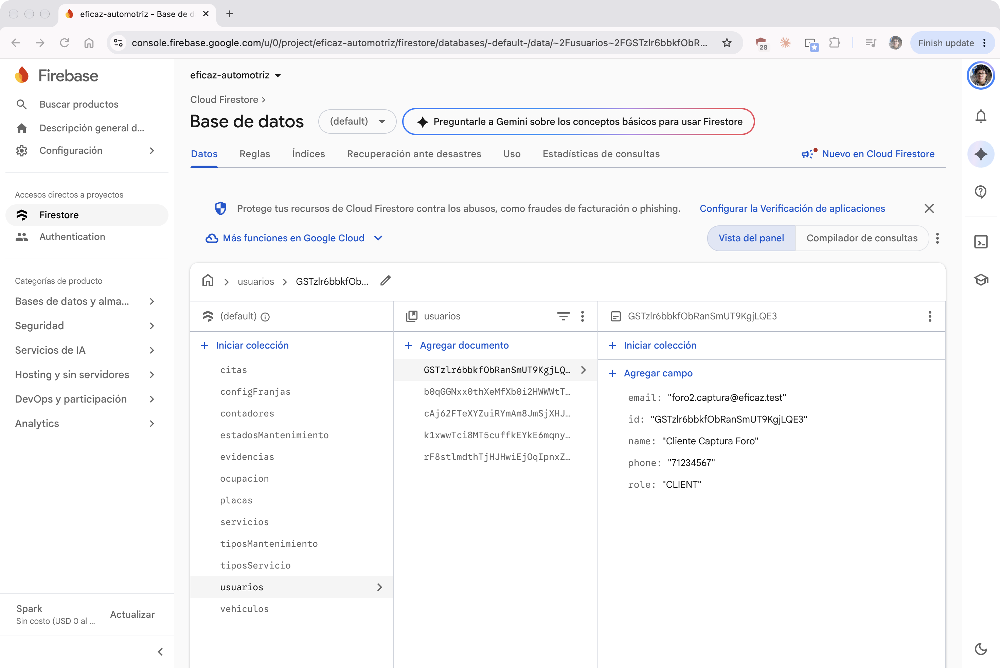

*Nota.* Captura de pantalla de la consola de Firebase del proyecto eficaz-automotriz, tomada por el equipo el 2 de noviembre de 2026.

**Figura 9**

*Cita APT-004, con el clientId de ese uid y vehicleId VEH-004*

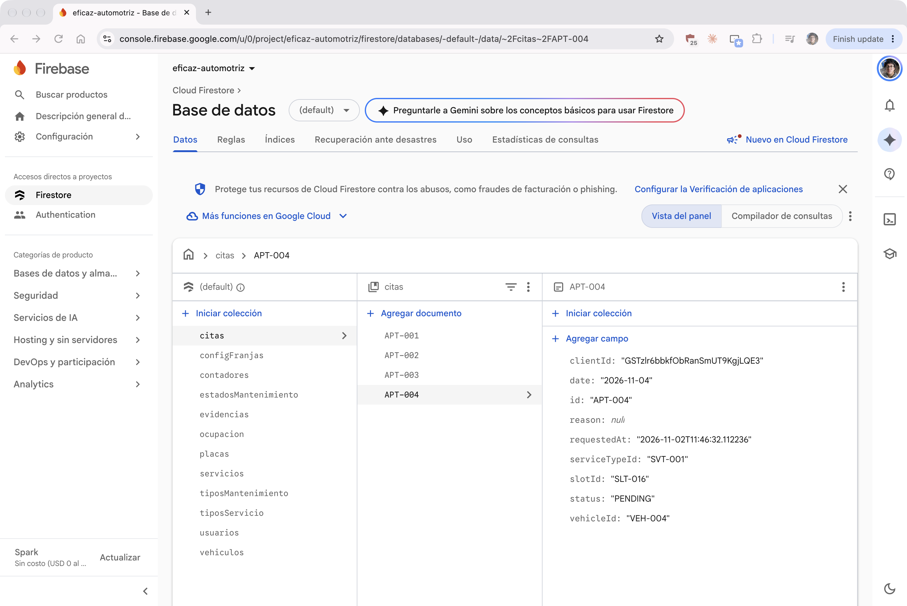

*Nota.* Capturas de pantalla de la consola de Firebase, tomadas por el equipo el 2 de noviembre de 2026. `foro2.captura@eficaz.test`, `APT-004` y `VEH-004` son datos de prueba. No son registros del taller.

## Reglas de seguridad e índices

### Qué garantizan las reglas

Las reglas de seguridad se evalúan en el servidor en cada lectura y cada escritura. El cliente no puede saltárselas desde la aplicación (Google, 2026h). El archivo `firestore.rules` del repositorio es el que se publica en la consola, en modo producción, fuera del modo de prueba. Cuatro funciones concentran las condiciones. `signedIn` exige `request.auth`. `me` lee `usuarios/{uid}` de la sesión. `isStaff` exige sesión y `role == 'STAFF'`. `isOwner` compara un campo del documento con `request.auth.uid`. Dos funciones más resuelven el dueño cuando el documento solo trae `vehicleId` o `serviceOrderId`: `ownsVehicle` y `ownsServiceOrder`.

```
function signedIn() { return request.auth != null; }
function me() { return get(/databases/$(database)/documents/usuarios/$(request.auth.uid)); }
function isStaff() { return signedIn() && me().data.role == 'STAFF'; }
function isOwner(ownerField) { return signedIn() && resource.data[ownerField] == request.auth.uid; }
```

*Nota.* Fragmento de `firestore.rules`. Las rutas `get` usan la sintaxis de reglas, no la del código Kotlin.

Una lectura de un identificador que no existe está permitida en varias colecciones (`resource == null`). No revela datos: `findById` recibe null y `nextId` puede sondear si un identificador está libre. Las consultas de lista no usan esa excepción.

### Reglas por colección

En `usuarios`, leer exige ser el dueño del `uid` o ser personal. Crear exige que el `uid` del documento sea el de la sesión y que `role` sea `CLIENT`. Actualizar exige ser el dueño y conservar el mismo rol: el cliente no puede nombrarse personal desde la aplicación. Borrar está prohibido.

```
match /usuarios/{uid} {
  allow read: if signedIn() && (request.auth.uid == uid || isStaff());
  allow create: if signedIn() && request.auth.uid == uid && request.resource.data.role == 'CLIENT';
  allow update: if signedIn() && request.auth.uid == uid && request.resource.data.role == resource.data.role;
  allow delete: if false;
}
```

En `vehiculos`, la lista solo devuelve documentos cuyo `ownerId` es el `uid`, salvo que quien consulta sea personal. Crear exige ese `ownerId` y, además, que en la misma transacción exista `placas/{plate}` apuntando a este vehículo. Así la placa no puede reclamarse dos veces: la regla de `placas` solo permite crear un documento que no existía. Actualizar lo hace el dueño o el personal. Borrar, el dueño.

En `citas`, la lista exige `clientId` igual al `uid`, o personal. Crear exige ese `clientId` y `status == 'PENDING'`. Actualizar lo hace el personal sin más condiciones de estado. El cliente solo puede cancelar, o responder a una cita que está `RESCHEDULED` pasándola a `CONFIRMED` o a `CANCELLED`. No hay borrado.

```
allow create: if signedIn() && request.resource.data.clientId == request.auth.uid && request.resource.data.status == 'PENDING';
allow update: if isStaff()
  || (isOwner('clientId') && request.resource.data.status == 'CANCELLED')
  || (isOwner('clientId') && resource.data.status == 'RESCHEDULED'
      && request.resource.data.status in ['CONFIRMED', 'CANCELLED']);
```

En `servicios` y `evidencias`, leer exige personal o ser dueño del vehículo de la orden. Escribir es solo del personal: el historial es de lectura para el cliente. En `estadosMantenimiento` el dueño puede crear la línea base de su vehículo, actualizarla sin cambiar `vehicleId` y borrarla junto con el vehículo. El personal escribe al cerrar el servicio. `tiposServicio`, `tiposMantenimiento` y `configFranjas` se leen con sesión y se escriben solo con personal.

`contadores/{name}` guarda el último número emitido. Cualquier sesión autenticada puede leerlo. Crear exige un único campo `value`, de tipo entero, igual a 1, salvo que quien crea sea personal. Actualizar solo suma exactamente 1, o deja al personal subirlo más sin bajarlo. No se borra. Esa forma es la que `nextId` necesita: una transacción que lee el valor y escribe el siguiente.

```
function validCounter() {
  return request.resource.data.keys().hasOnly(['value']) && request.resource.data.value is int;
}
```

`placas/{plate}` se lee con sesión. Crear exige exactamente `vehicleId` y `ownerId`, con `ownerId` igual al `uid` o con personal. No se actualiza. Se borra por el dueño o por el personal. `ocupacion/{key}` guarda el cupo. Crear exige `count` 1, o cualquier valor si es personal, y el identificador del documento tiene que ser `date + '_' + slotId`. Actualizar permite sumar 1, restar 1 o, si es personal, otro ajuste, sin cambiar `date` ni `slotId`, y con `count` mayor o igual que cero. Solo el personal borra el contador de cupo.

```
function validOccupancy(key) {
  let data = request.resource.data;
  return data.keys().hasOnly(['date', 'slotId', 'count'])
    && data.count is int && data.count >= 0
    && key == data.date + '_' + data.slotId;
}
```

El límite de ±1 no ata el contador a una cita concreta. Por eso el personal vuelve a evaluar la disponibilidad al confirmar. El README deja esa limitación escrita: la regla impide saltos arbitrarios del cliente, y la confirmación repite la regla de negocio.

La Figura 10 abre las reglas de Firestore en la consola del proyecto. La Figura 11 es el simulador de esa pantalla: el aviso dice «Se rechazó la operación de escritura simulada».

**Figura 10**

*Reglas de Firestore del proyecto eficaz-automotriz en la consola*

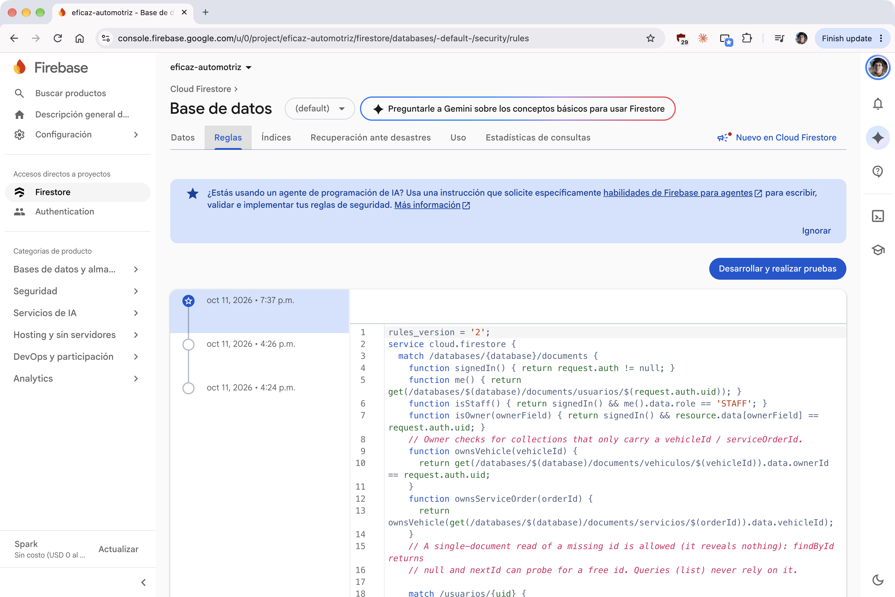

*Nota.* Captura de pantalla de la consola de Firebase del proyecto eficaz-automotriz, tomada por el equipo el 2 de noviembre de 2026.

**Figura 11**

*Simulador de reglas: la escritura de prueba fue rechazada*

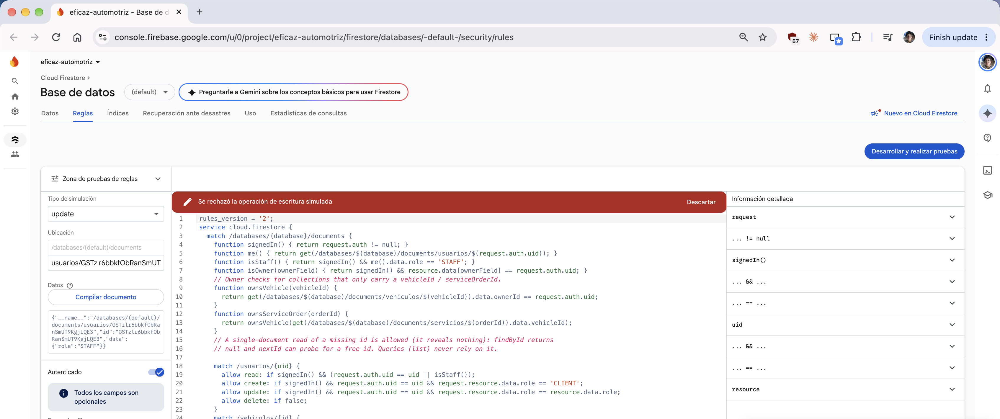

*Nota.* Captura de pantalla de la consola de Firebase del proyecto eficaz-automotriz, tomada por el equipo el 2 de noviembre de 2026.

### Índices

Cloud Firestore crea por defecto un índice automático para cada campo. Esos índices, antes llamados de un solo campo, cubren la igualdad, el rango sobre ese mismo campo y la igualdad compuesta: varias cláusulas `==` a la vez. El índice manual, antes llamado compuesto, hace falta cuando la consulta combina un rango (`<`, `<=`, `>` o `>=`) con otros filtros, o cuando ordena por un campo distinto del que filtra (Google, 2026j).

La única consulta del repositorio que filtra dos campos a la vez es `FirestoreMaintenanceRecordRepository.findByVehicleAndType`. Iguala `vehicleId` y `maintenanceTypeId`, y no llama a `orderBy`. La guía incluye esa igualdad compuesta entre lo que ya resuelven los índices automáticos. El archivo `firestore.indexes.json` la deja declarada como índice manual, y el README pide publicarlo con `firebase deploy --only firestore:indexes`:

```json
{
  "collectionGroup": "estadosMantenimiento",
  "queryScope": "COLLECTION",
  "fields": [
    { "fieldPath": "vehicleId", "order": "ASCENDING" },
    { "fieldPath": "maintenanceTypeId", "order": "ASCENDING" }
  ]
}
```

No hay en el código otra combinación de campos. `FirestoreTimeSlotRepository.findByDay` filtra solo `dayOfWeek` y ordena el resultado en memoria: el comentario del archivo dice que así evita un índice manual de `dayOfWeek` y `startTime`. El resto de las consultas igualan un solo campo (`ownerId`, `clientId`, `vehicleId`, `serviceOrderId`, `status`, `date` de `ocupacion`) o aplican un rango sobre el único campo `date` de `citas`. Esas consultas usan el índice automático de ese campo.

La Figura 12 muestra ese índice en la consola, en estado Habilitado.

**Figura 12**

*Índice de estadosMantenimiento habilitado en la consola*

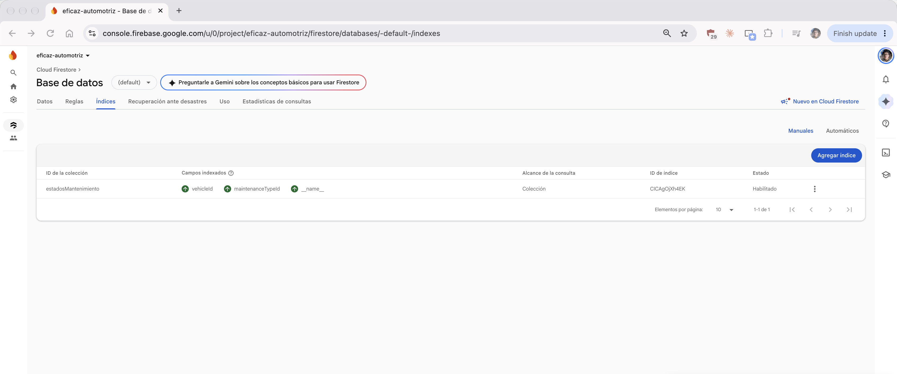

*Nota.* Captura de pantalla de la consola de Firebase, tomada por el equipo el 2 de noviembre de 2026. La consola lista `vehicleId`, `maintenanceTypeId` y `__name__`. El archivo `firestore.indexes.json` declara los dos primeros.

## Sincronización en tiempo real

### Dónde hace falta

La guía de Firestore describe listeners que vuelven a entregar el resultado cuando el documento cambia (Google, 2026g). En este proyecto eso importa solo donde el dato lo modifica otro dispositivo mientras la pantalla está abierta. Hay tres casos.

El primero es Mis citas (`AppointmentsScreen`, `AppointmentsViewModel`). El personal confirma, reprograma o rechaza, y el cliente tiene que ver el estado nuevo sin volver a entrar. `AppointmentsViewModel.load` recoge `AppointmentRepository.observeByClient(clientId)`.

El segundo es el Panel del personal (`StaffPanelScreen`, `StaffPanelViewModel`). Una solicitud nueva entra en las pendientes. Cancelar una cita ya confirmada no entra en esa consulta, y la agenda sí tiene que reflejarla. `StaffPanelViewModel.load` combina `observePending()` y `observeAll()`.

El tercero es el Detalle del servicio del cliente (`ServiceDetailScreen`, `ServiceDetailViewModel`). El personal cambia el estado de la orden o agrega una evidencia, y el cliente está mirando esa orden. `ServiceDetailViewModel.load` combina `ServiceOrderRepository.observeById(id)` y `EvidenceRepository.observeByOrder(serviceOrderId)`.

Los métodos síncronos, entre ellos `findByClient`, `findByStatus` y `findByServiceOrder`, no se reemplazan. Los casos de uso de `:core` siguen devolviendo `Outcome` y no conocen el `Flow`.

### Diseño del listener

El `Flow` está declarado en las interfaces de `:core`: `AppointmentRepository`, `ServiceOrderRepository` y `EvidenceRepository`. No hay una interfaz aparte en `:app`. `InMemoryRepository` guarda la colección en un `MutableStateFlow` y lo publica en cada `save` y `deleteById`. Las subclases filtran con `snapshotWhere`. El modo demostración actualiza así la pantalla abierta, y las pruebas de dominio no importan Android. `AppGraph`, `FirebaseBackend` y `DataBackend` no ganan campos: ya inyectan esos repositorios, y el modo demostración usa la misma API.

Las firmas son estas. `observeByClient(clientId: String)` devuelve `Flow<List<Appointment>>` con las citas de ese cliente. `observePending()` devuelve las de estado `PENDING`. `observeAll()` devuelve la colección completa. `observeById(id: String)` devuelve `Flow<List<ServiceOrder>>`: la orden como lista de un elemento, o vacía si el documento no existe. `observeByOrder(serviceOrderId: String)` devuelve `Flow<List<Evidence>>` con las evidencias de esa orden.

En Firestore, `FirestoreRepository.observe` abre `addSnapshotListener` dentro de `callbackFlow`. La guía de flujos de Android señala `callbackFlow` para convertir una API de callback en un `Flow` (Google, 2026l). Si el listener informa un error, el flujo se cierra. Si el documento no se puede mapear, también. Cada emisión pasa por `fromDoc`, el mismo mapper que la lectura síncrona. `awaitClose` ejecuta `registration.remove()`. `observeDocument` escucha un solo documento y lo envuelve en una lista de cero o un elemento. Los métodos síncronos siguen en `Tasks.await`.

Los filtros respetan `firestore.rules`. Ese archivo no se modificó para estas consultas, y no hizo falta. `observeByClient` iguala `clientId` con el uid: la regla `list` de `citas` deja leer al dueño. `observePending` iguala solo `status` con `PENDING`. Sin `clientId`, esa regla niega la consulta al cliente y la admite al personal, igual que `findByStatus`. `observeAll` no filtra. La misma regla admite la lista completa al personal y la niega al cliente, igual que `findAll`. `observeById` no consulta la colección. Un filtro por identificador no restringe `vehicleId`, y la regla `list` de `servicios` exige el vehículo del dueño o el rol de personal. El listener de documento usa la regla `get`. `observeByOrder` iguala `serviceOrderId`. La regla `list` de `evidencias` admite esa consulta al dueño de la orden.

No se agregó ningún índice. Una igualdad sobre un solo campo usa el índice automático. El índice compuesto de `estadosMantenimiento`, sobre `vehicleId` y `maintenanceTypeId`, no interviene en estas escuchas.

El ViewModel recolecta con `viewModelScope`. La guía de corrutinas en Android asocia ese ámbito al ciclo del ViewModel y muestra `Dispatchers.IO` para el trabajo que no debe ocupar el hilo de la interfaz (Google, 2026k). `load` cancela el `Job` anterior y abre otro. En Mis citas el flujo es `observeByClient(actor.id)`. En el panel, cada emisión de citas vuelve a leer las órdenes con `serviceOrderService.listAll`: el panel no escucha la colección `servicios`. En el detalle, la cita vinculada se relee en cada snapshot con `appointmentService.listVisibleTo`. Esa pantalla no escucha `citas`. El armado de filas corre en `graph.io`, que en producción es `Dispatchers.IO`, y el `UiState` se publica en el hilo principal. Ningún archivo de `ui/` importa `com.google.firebase`.

El armado de cada emisión queda antes del `.catch`, y ese `catch` vuelve a lanzar `CancellationException`. Si ya hay un `UiState.Ready`, se conserva, y Mis citas y el panel muestran en `MessageSnackbar` el mensaje de sistema «No se pudo completar la operación. Revise su conexión e intente de nuevo.»; si todavía no hay `Ready`, se publica `UiState.Error`. El detalle no usa ese aviso: conserva el último estado listo y solo publica el error cuando aún no hay uno. Al salir de la pantalla, `viewModelScope` cancela el `Job` y `awaitClose` quita el registro. Un `load()` nuevo, al reanudar, al reintentar o después de escribir, sustituye el listener. En el panel, la escritura cancela el `Job` y `load()` lo vuelve a abrir al terminar, para releer las órdenes. En modo demostración, un `save` del repositorio en memoria emite el `MutableStateFlow` y el `UiState` cambia sin un segundo `load`. Eso lo cubre `RealtimeViewModelsTest`.

### Dónde no se usa, y por qué

No escuchan Firestore el inicio del cliente, los vehículos, el historial, el perfil, los reportes, los catálogos, las franjas, la recepción de una orden, el cierre, el alta de una cita ni la subida de una evidencia vista desde quien la está subiendo. En esos puntos el cambio lo hace la misma persona que tiene la pantalla, o el dato es un catálogo que se lee al abrir el formulario, o es un corte para un reporte. Un listener no aporta la coordinación entre dos dispositivos que la rúbrica pide, y cada escucha cuenta como lecturas mientras la pantalla sigue abierta (Google, 2026o).

Tampoco escucha Firestore el login. La sesión la sostiene Authentication con `currentUid()`. El modo demostración (`demo.inMemory=true` en una compilación debug) no abre Firebase. Usa los mismos métodos de observación sobre los repositorios en memoria, con las cuentas de prototipo del README.

Las escrituras que ya son transacción se quedan síncronas. Crear una cita actualiza `ocupacion` en la misma transacción. Crear un vehículo reclama `placas` en la misma transacción. `nextId` incrementa `contadores` en una transacción. Un listener no sustituye esa atomicidad (Google, 2026n).

La Figura 13 reúne los dos teléfonos cuando la cita `APT-004` ya está confirmada. En Mis citas del cliente el estado es Confirmada, y la agenda del panel muestra el mismo estado.

**Figura 13**

*Mis citas y el panel del personal, con la cita APT-004 confirmada en los dos*

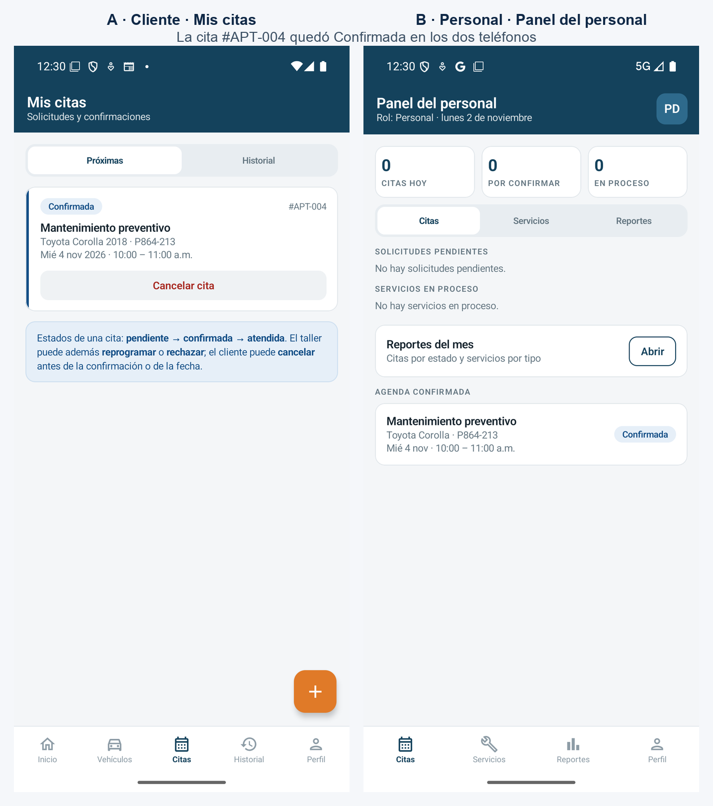

*Nota.* Capturas de pantalla de dos emuladores Pixel 8 (API 36), uno con la sesión del cliente y otro con la del personal, tomadas por el equipo el 2 de noviembre de 2026.

## Decisiones técnicas vinculadas al proyecto

### Casos de uso síncronos y corrutinas en el borde

Los servicios de `:core` siguen siendo síncronos y devuelven `Outcome`. Las lecturas y escrituras que no son listeners bloquean con `Tasks.await` dentro de `FirestoreRepository`. Las escuchas descritas en Sincronización en tiempo real no usan esa vía: el callback entrega la lista. `EficazViewModel` llama los casos de uso en `Dispatchers.IO` y publica el resultado en el hilo principal. Si alguien invocara `Tasks.await` en el hilo principal, el SDK lanzaría `IllegalStateException`: el propio repositorio lo trata como alarma, no como un modo de uso. Esta decisión evita reescribir los casos de uso y las pruebas del núcleo. El costo es el que el README ya anota: una transacción sin red falla, no queda en cola. La caché en disco está encendida en `firebaseBackend` con `PersistentCacheSettings`, antes de cualquier otra lectura, y sirve a las lecturas. No convierte las transacciones en una bandeja de salida.

### Identificadores con contador

El dominio pide identificadores legibles, `VEH-001`, `APT-002`, `SRV-003`. `User.id` es la excepción: es el `uid`, y `FirestoreUserRepository.nextId` lanza `UnsupportedOperationException` con el texto «The user id is the Firebase uid». Para el resto, `nextId` corre una transacción sobre `contadores/{colección}`: lee `value`, suma 1 y escribe el resultado. El formato es prefijo, guion y el número en tres dígitos. Si el identificador ya existe, o si la sonda recibe `PERMISSION_DENIED` porque el documento es de otra persona, prueba el siguiente, hasta 50 veces. El personal puede subir el contador de un salto cuando reconstruye datos anteriores; el cliente solo puede sumar uno, que es lo que la regla permite. El contador reemplaza la lectura de toda la colección, que las reglas ya no dejan hacer a un cliente.

### Imágenes en Cloudinary y URL en Firestore

La evidencia fotográfica no se guarda en Firestore. `CloudinaryUploader` envía el JPEG a `https://api.cloudinary.com/v1_1/{cloudName}/image/upload` con el campo `upload_preset` y guarda en `evidencias.imageUrl` el `secure_url` de la respuesta. Cloudinary documenta los presets de subida como la configuración de esa carga (Cloudinary, 2026). El proyecto usa un preset sin firma: el código no envía el secreto de la API, y el README fija la carpeta del preset en `eficaz/evidencias`. El nombre de la nube y el preset viven en `local.properties` (`cloudinary.cloudName`, `cloudinary.uploadPreset`). Si faltan esos valores, la subida explica en español que falta el nombre de la nube o el preset. En modo demostración la URL es ficticia y no hay red.

### Modo demostración sin Firebase

Con `demo.inMemory=true` en una compilación debug, `EficazApp` arma el grafo con `demoBackend`: repositorios en memoria, datos de los mockups y `InMemoryAuthGateway`. Esos repositorios emiten el `MutableStateFlow` descrito en Diseño del listener al guardar o borrar, así que Mis citas, el panel y el detalle se actualizan sin red. No hace falta `google-services.json`. El README documenta dos cuentas de prototipo, `cliente@demo.test` y `personal@demo.test`, ambas con la contraseña de demostración `Demo1234`. No hay inicio con Google. Release no activa este modo. Las reglas de negocio que se ejecutan son las mismas, porque los servicios de `:core` no saben si el repositorio está en memoria o en Firestore.

### Lo que la interfaz no puede importar

Ningún archivo de `ui/` importa `com.google.firebase` ni OkHttp. La pantalla de login recibe un token o un mensaje; el gateway y el ViewModel están del otro lado. Ningún archivo de `core` importa `android`. Esa frontera es la que permite probar el dominio sin emulador y coincide con la capa de interfaz que la guía de arquitectura separa de las fuentes de datos (Google, 2026i).

## Análisis del Equipo sobre la Adopción de Firebase

Firebase cubre, en este proyecto, el hueco que la Etapa 2 no tenía: hay una sesión real y hay datos compartidos entre el teléfono del cliente y el del personal, sin escribir un servidor. El `uid` como identificador de `User` encaja con `AuthService.signIn(uid)`, que ya buscaba un usuario por id desde la consola. Las reglas trasladan al servidor el mismo corte de roles que `requireStaff` aplica en el dominio. Esa coincidencia es la ventaja principal que el equipo observa. La segunda es de plazo: Authentication y Firestore estaban disponibles para una entrega de cátedra, y el modo demostración permite correr la aplicación cuando la consola no está configurada.

Los límites también son concretos. El costo acompaña a las lecturas, las escrituras y los listeners (Google, 2026o). Por eso la aplicación no pone un listener en cada pantalla: una escucha abierta en reportes o en catálogos sumaría lecturas sin cambiar lo que el usuario necesita ver. La caché en disco alivia las lecturas repetidas y no convierte una transacción fallida en una operación en cola. Quien use la aplicación sin red puede ver datos ya leídos y va a recibir un error, en español, al crear un vehículo, una cita o un identificador.

El proyecto queda apoyado en un solo proveedor para la identidad y para los documentos. Mover el almacenamiento exigiría volver a escribir los repositorios de `:app` y las reglas. El dominio aguantaría ese cambio porque no importa Firebase: esa frontera es lo que el equipo haría igual si empezara de nuevo. Lo que haría distinto es el inicio con Google. El código ya sabe que `GoogleSignIn` está obsoleto y que Credential Manager es la vía documentada hoy (Google, 2026a). Cambiarlo a mitad de la etapa habría abierto otro flujo de token sin mejorar las reglas ni el modelo. Queda como deuda visible, no como desconocimiento.

Las consultas que la aplicación usa no unen colecciones. Un reporte que cruza citas, vehículos y servicios arma ese cruce en memoria, después de varias lecturas. Es el modelo de las consultas de igualdad y de rango sobre una colección (Google, 2026m). Un backend con SQL lo expresaría en una sentencia. Aquí el costo se paga en lecturas y en código de ViewModel. El equipo lo acepta porque el volumen del prototipo es el de una demostración, no el de un taller en producción, y porque las reglas pueden autorizar cada lectura por el `uid`. Aun así, es el punto que más se parece a la API REST que un libro introductorio de aplicaciones móviles resuelve en el servidor (Román Gallardo et al., 2020): alguien tiene que componer los datos. En este proyecto lo hace el teléfono, dentro de los permisos que las reglas ya filtraron.

Las reglas son difíciles de probar desde las pruebas unitarias. Esas pruebas usan repositorios en memoria y no evalúan `firestore.rules`. Una escritura que el dominio permite y la regla niega solo aparece contra un proyecto real: de ahí la Figura 11 y la revisión manual de que cada `save` del código tenga una cláusula `allow` compatible. El equipo escribió las reglas al lado de las transacciones de `placas`, `ocupacion` y `contadores` para que esa revisión se pueda hacer leyendo un archivo. No sustituye ejecutarlas.

Lo que el equipo mantendría es el mapa manual y el rol `CLIENT` fijo en el registro. Lo que acotaría desde el principio es la lista de pantallas con listener, que es la del apartado Dónde hace falta, para no convertir toda la aplicación en una suscripción. Y dejaría el modo demostración como está: es el que permite mostrar las reglas de negocio cuando Firebase no está sobre la mesa.

La revisión del código contra las pruebas dejó dos límites que un diagrama de login no muestra. Una carga de perfil que termina después de cerrar sesión, o después de pasar de la cuenta A a la B, no publica el estado viejo: `loadGeneration` la descarta y `AppRoot` vacía el `SessionViewModelStoreOwner` cuando cambia el uid. Dentro de un `Flow`, el armado de la pantalla va antes del `.catch` y `CancellationException` se relanza, para que salir de la pantalla cancele el listener y no aparezca como un fallo de red.

## Conclusiones

Primera. Firebase Authentication resolvió la identidad sin que el equipo escribiera un servidor. El `uid` que entrega el servicio se convirtió en el identificador de `User`, y eso permitió conectar el inicio de sesión con `AuthService.signIn(uid)` sin cambiar el núcleo de la Etapa 2. Los dos proveedores que pide el avance, correo con contraseña y Google, comparten el mismo destino: un perfil en `usuarios/{uid}` con rol `CLIENT`.

Segunda. Cloud Firestore guarda los datos del proyecto asociados al usuario autenticado. Cada consulta de cliente filtra por `ownerId`, `clientId` o por el vehículo del dueño, y las reglas de seguridad exigen ese mismo filtro en el servidor. La protección de los datos no depende de que la aplicación se comporte bien: depende de `firestore.rules`.

Tercera. La sincronización en tiempo real se aplicó solo donde dos dispositivos cambian el mismo dato: Mis citas, el Panel del personal y el Detalle del servicio. Limitarla a esas tres pantallas mantuvo el costo de lecturas bajo control y dejó intactos los casos de uso síncronos de `:core`.

Cuarta. La separación entre `:core` y `:app` fue la decisión que más facilitó la integración. Como el dominio no importa Firebase, las pruebas siguen corriendo sin emulador y el modo demostración ejecuta las mismas reglas de negocio con repositorios en memoria.

Quinta. Firebase también deja límites a la vista: dependencia de un solo proveedor, consultas sin uniones entre colecciones y reglas que las pruebas unitarias actuales no evalúan. El equipo los conoce y los registra como deuda técnica, no como problemas ocultos.

## Recomendaciones

Primera. Migrar el inicio con Google de `GoogleSignIn` a Credential Manager antes de la entrega final, porque es la vía que la documentación actual de Android propone para ese mismo gesto (Google, 2026a).

Segunda. Agregar pruebas automáticas de las reglas de seguridad con Firebase Local Emulator Suite, que permite validar `firestore.rules` en un entorno local sin tocar los datos del proyecto (Google, s. f.). Así una escritura que el dominio permite y la regla niega aparecería en una prueba y no solo frente a la consola.

Tercera. Mantener la lista de pantallas con listener tal como quedó en este avance y revisar el consumo de lecturas en la consola antes de añadir una nueva escucha (Google, 2026o).

Cuarta. Conservar el modo demostración para la defensa final. Permite mostrar las tres reglas de negocio aunque falle la red o la configuración de Firebase.

## Referencias

Cloudinary. (2026, 19 de octubre). *Upload presets*. Cloudinary Documentation. https://cloudinary.com/documentation/upload_presets

Google. (s. f.). *Build unit tests*. Firebase. https://firebase.google.com/docs/rules/unit-tests

Google. (2026a, 28 de octubre). *About Sign in with Google*. Android Developers. https://developer.android.com/identity/sign-in/credential-manager-siwg

Google. (2026b, 28 de octubre). *Add data to Cloud Firestore*. Firebase. https://firebase.google.com/docs/firestore/manage-data/add-data

Google. (2026c, 28 de octubre). *Authenticate with Firebase using password-based accounts on Android*. Firebase. https://firebase.google.com/docs/auth/android/password-auth

Google. (2026d, 28 de octubre). *Authenticate with Google on Android*. Firebase. https://firebase.google.com/docs/auth/android/google-signin

Google. (2026e, 20 de octubre). *Firebase Authentication*. Firebase. https://firebase.google.com/docs/auth

Google. (2026f, 28 de octubre). *Firestore*. Firebase. https://firebase.google.com/docs/firestore

Google. (2026g, 28 de octubre). *Get realtime updates with Cloud Firestore*. Firebase. https://firebase.google.com/docs/firestore/query-data/listen

Google. (2026h, 28 de octubre). *Get started with Cloud Firestore Security Rules*. Firebase. https://firebase.google.com/docs/firestore/security/get-started

Google. (2026i, 5 de octubre). *Guide to app architecture*. Android Developers. https://developer.android.com/topic/architecture

Google. (2026j, 28 de octubre). *Index types in Cloud Firestore*. Firebase. https://firebase.google.com/docs/firestore/query-data/index-overview

Google. (2026k, 24 de septiembre). *Kotlin coroutines on Android*. Android Developers. https://developer.android.com/kotlin/coroutines

Google. (2026l, 8 de octubre). *Kotlin flows on Android*. Android Developers. https://developer.android.com/kotlin/flow

Google. (2026m, 28 de octubre). *Perform simple and compound queries in Cloud Firestore*. Firebase. https://firebase.google.com/docs/firestore/query-data/queries

Google. (2026n, 28 de octubre). *Transactions and batched writes*. Firebase. https://firebase.google.com/docs/firestore/manage-data/transactions

Google. (2026o, 28 de octubre). *Understand Cloud Firestore billing*. Firebase. https://firebase.google.com/docs/firestore/pricing

Román Gallardo, A., Flores Cortés, C. A. y Herrera Morales, J. R. (2020). *Programación de aplicaciones móviles con React Native*. Editorial BUK. https://buk.com.mx/9786079878214/description
